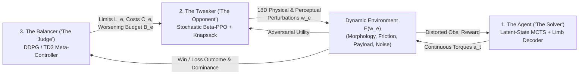

# Latent-State Continuous MCTS (`la_mcts`) & Balanced Reinforcement Learning (`BRL`)

**Experimental Research Prototype Combining Latent-Space Tree Search, Three-Agent Adversarial Curriculum Control, and Peak-Conditioned Morphological Limb Transformers**

**Author & Principal Architect:** **Peter Szakony** — **Resilient Coder PS e.U.** (Austria)  
**Contact:** `peter.szakony@hotmail.com` | **License:** Apache 2.0 | **Manuscript Draft:** [paper/main.tex](paper/main.tex)

> [!NOTE]
> **Research Status & Terminology Note:**
> * **Work in Progress:** This repository is an **experimental research prototype**. Training and ablation runs are currently underway; no converged benchmark optimality or superhuman performance is claimed yet.
> * **Acronym Disambiguation:** In existing optimization literature, **LA-MCTS** denotes *Latent Action Monte Carlo Tree Search* for black-box optimization via SVM space partitioning (Wang et al., NeurIPS 2020). This project instead implements a **Latent-State Continuous MCTS** planner building on *Sampled MuZero* and *EfficientZero* for continuous control (retaining the `la_mcts/` package name for codebase continuity).

---

## TL;DR

* **Objective:** Investigate whether combining (1) latent-space continuous MCTS planning, (2) a three-agent game-theoretic curriculum (*Balanced Reinforcement Learning*), and (3) a peak-conditioned kinematic limb transformer enables robust locomotion under severe dynamics/perception perturbations and zero-shot morphological transfer.
* **What Builds on Prior Literature vs. What Is New Here:**

| Component | Prior Literature / Foundation | Contribution in This Repository |
| :--- | :--- | :--- |
| **Latent MCTS & Representation (`la_mcts/`)** | **MuZero** (Schrittwieser et al., 2020), **Sampled MuZero** (Hubert et al., 2021), **EfficientZero** SimSiam consistency (Ye et al., 2021), **DreamerV3** Symlog two-hot critic (Hafner et al., 2023) | Continuous GMM + Sampled PUCT integration with pre-tanh per-dimension policy loss, differentiable peak+Gaussian entropy regularization, and adaptive exploration scaling |
| **3-Agent Curriculum (`brl_core/`)** | **RARL** (Pinto et al., 2017), **PAIRED** (Dennis et al., 2020), differentiable optimization layers | **Three-player Agent–Tweaker–Balancer game** adding a TD3/DDPG Meta-Controller (*Balancer*) that regulates per-parameter limits $L_e$, costs $C_e$, and budget $B_e$ via a **Differentiable Bounded Knapsack Projection** (KKT bisection + implicit differentiation) targeting a 50% ZPD win-rate equilibrium |
| **Morphological Control (`MorphologicalLimbHead`)** | Transformer-based universal limb control (**MetaMorph**, Gupta et al., 2022) | **Peak-Conditioned Compositional Limb Decoder**: fuses 8D harmonic attachment kinematics `(x, y, z, yaw, pitch)` with sinusoidal+learnable **Peak Positional Encodings** `[0..M-1]` in a Transformer Encoder-Decoder so each GMM peak models a coordinated whole-body joint composition |

---

## 1. Motivation & Core Philosophy

Standard Reinforcement Learning (RL) policies often perform well in narrow, stationary training regimes but degrade rapidly under unexpected physical disturbances, sensor degradation, or structural morphological changes (such as limb amputation or altered body topologies).

Classic board-game agents such as AlphaGo benefited from two properties that do not transfer trivially to continuous physical control:
1. **Exact forward rules for tree search** (replaced in continuous domains by learned latent world models as in MuZero / Sampled MuZero).
2. **Self-play curriculum adaptation**, where an opponent naturally scales in difficulty alongside the agent.

This repository explores an end-to-end continuous-control architecture uniting:
1. **Latent-State Continuous MCTS (`la_mcts/`)**
2. **Three-Agent Balanced Reinforcement Learning (`brl_core/`)**
3. **Peak-Conditioned Harmonic Limb-Attachment Transformers (`MorphologicalLimbHead`)**

---

## 2. Latent-State Continuous MCTS (`la_mcts/`)

### Planning Without Observation Reconstruction
Simulating future raw observations (e.g., high-dimensional proprioception or images) across multiple tree depths introduces compounding reconstruction error. Following **MuZero** and **Sampled MuZero**, the planner avoids observation reconstruction inside the tree and unrolls a lightweight latent dynamics model directly in normalized representation space:

```text
latent(N) + action(N) ──► [FiLM Residual Latent Dynamics Model] ──► latent(N+1), reward(N)
```

To adapt this to continuous multi-limb actuation without premature policy collapse, `la_mcts/` includes:
* **Pre-tanh Per-Dimension Policy Cross-Entropy:** Evaluates `log_prob_pre_tanh` in unconstrained action space (`atanh(a)`) normalized per active joint dimension, avoiding the large negative constant offset from the detached $\tanh$ Jacobian.
* **Differentiable Mixture + Gaussian Entropy Regularization (`lambda_ent`):** Combines Categorical peak selection entropy and mixture-weighted Gaussian entropy to prevent early standard-deviation collapse or single-peak collapse.
* **Adaptive MCTS Exploration:** Scales MCTS sampling temperature (`root_tau_beta`), action temperature (`tau_act`), and root Dirichlet exploration fraction when running `policy_std` drops below `min_policy_std_target`.

---

## 3. Balanced Reinforcement Learning (BRL)

Two-player adversarial setups (Agent vs. Adversary, as in RARL or min-max RL) face a well-known failure mode in unconstrained physical environments: an adversary can trivialize the game by immediately driving physics parameters (e.g., friction $\to 0$ or extreme mass) into unsolvable regimes before the agent learns basic control.

**Balanced Reinforcement Learning (BRL)** introduces a **three-agent hierarchy** designed to keep perturbation difficulty within the agent's Zone of Proximal Development (ZPD, targeting $\approx 50\%$ win rate):



1. **The Agent (`la_mcts/`):** Learns to solve the perturbed control task.
2. **The Tweaker (`brl_core/tweaker.py`, `brl_core/knapsack_proj.py`):** A stochastic Beta-policy PPO adversary proposing an 18D perturbation vector $w_e$ (limb lengths, torso payload, friction, damping, actuator degradation, wind, sensor noise/dropout/latency), projected onto the feasible constraint set $0 \le w_i \le L_{e,i},\ \sum_i C_{e,i} w_i \le B_e$ via a **Differentiable Bounded Knapsack Projection** (vectorized KKT Lagrange multiplier bisection in `forward()` and analytical implicit hyperplane differentiation in `backward()`).
3. **The Balancer (`brl_core/balancer.py`):** A TD3/DDPG meta-controller observing rolling returns, win rate, and empirical failure correlations $\boldsymbol{\rho}_{\text{fail}}$ to regulate limits $L_e$, costs $C_e$, and budget $B_e$ around the target win rate (`0.50`).

---

## 4. Peak-Conditioned Universal Kinematic Limb Representation

Building on universal Transformer limb control (such as MetaMorph), `MorphologicalLimbHead` represents each limb by its **3D torso-relative attachment anchor** $(x_i, y_i, z_i)$ and **instantaneous pointing direction** $(\phi_{\text{yaw},i}, \phi_{\text{pitch},i})$, projected into an 8D harmonic feature vector:

$$[x, y, z, \phi_{\text{yaw}}, \cos(2\pi\phi_{\text{yaw}}), \sin(2\pi\phi_{\text{yaw}}), \phi_{\text{pitch}}, \sin(\pi\phi_{\text{pitch}})]$$

### Coordinated Multi-Limb Compositions via Peak Positional Encoding
Outputting independent distributions per limb from a shared token does not couple multi-limb **combinations** across mixture modes. To model coordinated whole-body gaits across GMM peaks:
1. A **Pre-LN Transformer Encoder** processes `[global_latent_z_t, limb_1, ..., limb_N]` so all limbs share global and cross-limb context.
2. **Peak Positional Encoding (`PeakPositionalEncoding`)** combines sinusoidal and learnable embeddings for peak indices $[0, 1, \dots, M-1]$.
3. A **Pre-LN Transformer Decoder** receives fused `(limb_i, peak_m)` queries across all $M \times N_{\text{limbs}}$ tokens, cross-attends to the encoder memory, and predicts per-peak, per-limb mixture logits, means $\boldsymbol{\mu}_{m,i}$, and log-stds $\log \boldsymbol{\sigma}_{m,i}$.
4. When sampling (`sample_actions` / `select_composition`), a single peak index $m^*$ is drawn from the mixture and all limbs' joint actions are sampled jointly from peak $m^*$, selecting a coordinated whole-body action composition.

---

## 5. Current Status & Evaluation Protocol

> [!IMPORTANT]
> **Active Training & Benchmark Reality Check:**
> Long-horizon multi-seed training (`10,000` episodes on `Ant-v5`, with `warmup_episodes` before full BRL perturbation escalation) is currently running. Early preliminary runs exhibited known failure modes that are actively being tuned (including negative `tanh`-Jacobian policy loss offsets, early standard-deviation collapse, passive upright survival without forward speed, and premature post-warmup budget spikes).
>
> For scientific context, standard converged model-free and model-based baselines on nominal `Ant-v5` (e.g., SAC, TD-MPC2, DreamerV3) achieve **+4,000 to +6,500 episode return** and **100–250 m** forward distance over 1,000 steps (`2–5 m/s`). Validated converged results, learning curves, and baseline comparisons will be reported only after full convergence is confirmed.

### Zero-Shot Morphological & Robustness Evaluation Suite
During evaluation (`experiments/train_ant_brl.py`, `dog_morph_env/`, `humanoid_morph_env/`), a single policy trained on 4-legged `Ant-v5` is evaluated every `eval_interval` episodes across:
* **Nominal `Ant-v5`** (4 legs / 8 actuators, baseline)
* **Tripod-Ant** (3 legs / 6 actuators, amputated limb)
* **Spider-Ant** (4 elongated legs)
* **Heavy-Ice-Ant** ($0.2\times$ surface friction, $1.5\times$ torso mass)
* **Hexapod-Ant** (6 legs / 12 actuators, unseen topology)
* Additional morphological unit environments in `dog_morph_env/` (Unitree Go1) and `humanoid_morph_env/` (`Humanoid-v5`).

---

## 6. Architecture & Hyperparameter Specification (Current Codebase)

All defaults below reflect [config/default_config.yaml](config/default_config.yaml) and [config/__init__.py](config/__init__.py):

### A. Solver Agent (`la_mcts/`)
1. **Backbone (`la_mcts/backbone.py`):**
   * Projects observation $s_t \in \mathbb{R}^{D_s}$ into $K_{\text{tok}} = 8$ tokens of dimension $d_{\text{model}} = 256$, plus 2 conditioning tokens for normalized context $w_e / 1000 \in \mathbb{R}^{18}$ and rolling transition history ($H = 6$).
   * $L_{\text{enc}} = 2$ Pre-LN MHSA blocks (`n_heads = 4`), attention-weighted pooling, LayerNorm, and row-wise Min-Max normalization into $z_t \in [0, 1]^{256}$.
2. **Peak-Conditioned GMM Actor & Limb Head (`la_mcts/gmm_heads.py`):**
   * $M = 4$ Tanh-squashed GMM peaks with `log_std_bounds = [-1.0, 1.0]`.
   * `MorphologicalLimbHead`: Pre-LN Transformer Encoder-Decoder (`hidden_dim = 128`, `n_heads = 4`, `n_enc_layers = 1`, `n_dec_layers = 1`) with `PeakPositionalEncoding` and per-`(peak, limb)` weight, mean, and log-std heads.
   * Trained with pre-tanh per-dimension cross-entropy (`lambda_p = 0.25`) and `entropy_proxy` regularization (`lambda_ent = 0.03`).
3. **Categorical Support Critic (`SupportCriticHead`):**
   * `301` discrete bins spanning `[-150, 150]` under an invertible `symlog` transform, trained via two-hot cross-entropy (`lambda_v = 0.5`).
4. **FiLM Residual Latent Dynamics & SimSiam Consistency (`la_mcts/rep_trainer.py`):**
   * $L_{\text{dyn}} = 3$ FiLM-modulated residual blocks predicting $(\hat{z}_{t+1}, \hat{r}_t)$, plus SimSiam Projector/Predictor (`proj_dim = 512`, `pred_dim = 256`, `lambda_rep = 2.0`, `lambda_r = 1.0`) over $K = 5$ unroll steps.
5. **Sampled Continuous PUCT MCTS & Reanalyze (`la_mcts/sampled_mcts.py`, `la_mcts/agent.py`):**
   * $N_{\text{sim}} = 32$ (`64` at eval), $K_{\text{act}} = 16$, virtual-loss leaf batching, PUCT ($c_1 = 1.25, c_2 = 19652$), root Dirichlet noise ($\alpha = 0.3$, base fraction $0.35$), adaptive exploration (`min_policy_std_target = 0.40`, `exploration_boost_max = 2.0`), `batch_size = 128`, `train_every_steps = 25`, and MuZero Reanalyze (`reanalyze_every = 4`, `reanalyze_states = 8`).

### B. Adversarial Tweaker (`brl_core/tweaker.py`, `brl_core/knapsack_proj.py`)
* 2-layer LayerNorm-SiLU Actor-Critic (256 units) outputting $\text{Beta}(\alpha, \beta)$ perturbations over $(0, 1)^{18}$, updated with Clipped PPO (`tweaker_lr = 3e-4`), followed by `DifferentiableKnapsackProjection` (`budget_max = 4500.0`, `warmup_budget = 100.0`).

### C. Balancer Meta-Controller (`brl_core/balancer.py`)
* 3-layer LayerNorm-ReLU Actor with Sigmoid output and Twin Q-Critics (256 units; `balancer_lr = 1e-4`, $\tau = 0.005$), regulating $(L_e, B_e, C_e)$ toward target win rate `0.50` (`ema_beta_w = 0.05`, `tau_s = 500.0`).

---

## 7. Repository Structure & Quickstart

```text
├── ant_morph_env/          # Procedural MuJoCo XML generator (3, 4, 6 legs) & 18D BRL Gymnasium wrapper
├── dog_morph_env/          # Unitree Go1 quadruped morphological & adversarial BRL environment
├── humanoid_morph_env/     # Humanoid-v5 morphological & adversarial BRL environment
├── brl_core/               # Balanced Reinforcement Learning core:
│   ├── balancer.py         #   DDPG/TD3 Meta-Controller ("The Judge")
│   ├── tweaker.py          #   Stochastic Beta-PPO Adversary ("The Opponent")
│   ├── knapsack_proj.py    #   Differentiable KKT Bounded Knapsack Projection Layer
│   ├── perception.py       #   Sensor noise, dropout, latency & morphological distortion filter
│   └── orchestrator.py     #   Co-evolutionary 3-agent training loop
├── la_mcts/                # Latent-State Continuous MCTS core:
│   ├── backbone.py         #   Sub-State Tokenizer & Pre-LN Multi-Head Self-Attention Backbone
│   ├── gmm_heads.py        #   Peak-Conditioned Tanh-GMM Actor, MorphologicalLimbHead & SupportCriticHead
│   ├── rep_trainer.py      #   Action-Conditioned FiLM Latent Dynamics & SimSiam Consistency Head
│   ├── sampled_mcts.py     #   Sampled Continuous PUCT MCTS Engine with virtual-loss batching
│   └── agent.py            #   Trajectory Replay Buffer, K-step Unroll Trainer & MuZero Reanalyze
├── config/                 # Configuration package (__init__.py dataclasses & default_config.yaml)
├── experiments/            # Training, evaluation, plotting & MuJoCo video rendering scripts
├── paper/                  # LaTeX manuscript draft (main.tex) and BibTeX references (references.bib)
└── tests/                  # Unit and integration tests
```

### Running Tests & Training

```powershell
# 1. Activate virtual environment
.\.venv\Scripts\Activate.ps1

# 2. Run unit & morphological integration tests
.\.venv\Scripts\python.exe -m pytest tests/test_morphological_limb_head.py tests/test_dog_wrapper.py tests/test_humanoid_wrapper.py -v

# 3. Launch multi-seed BRL + Latent-State MCTS training
.\.venv\Scripts\python.exe experiments/train_ant_brl.py

# 4. Generate multi-seed progress charts
.\.venv\Scripts\python.exe experiments/plot_progress.py
```

---

## 8. Authorship, Attribution & Disclosure

* **Author & Principal Architect:** **Peter Szakony**  
* **Affiliation:** **Resilient Coder PS e.U.** (Austria)  
* **Email:** `peter.szakony@hotmail.com`  
* **Attribution & AI Disclosure:** The three-agent BRL curriculum with Differentiable Knapsack Projection, the Peak-Conditioned Harmonic Limb-Attachment Transformer design, and the overall system integration were conceived by **Peter Szakony (Resilient Coder PS e.U.)**, building explicitly upon MuZero / Sampled MuZero, EfficientZero, DreamerV3, RARL/PAIRED, and MetaMorph. AI coding assistants were used to help implement parts of the simulation wrappers, neural modules, test suites, and documentation.

---

## 9. Citation

```bibtex
@misc{szakony2026brl_latent_mcts,
  title={Latent-State Continuous MCTS and Balanced Reinforcement Learning for Perturbed Control and Zero-Shot Morphological Locomotion},
  author={Szakony, Peter},
  year={2026},
  note={Work in progress; Resilient Coder PS e.U., Austria. Email: peter.szakony@hotmail.com}
}
```
