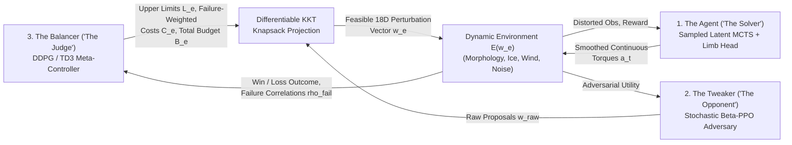

# Balanced Reinforcement Learning (BRL) & Discrete Joint Kinematic Architecture for Zero-Shot Morphological Locomotion

**Cybernetic 3-Agent Self-Play Curriculum, Differentiable Knapsack Perturbation Control, and Universal Limb-Attachment Transformers with Sampled Latent MCTS**

**Principal Architect & Researcher:** **Peter Szakony** — **Resilient Coder PS e.U.** (Austria)  
**Contact:** `peter.szakony@hotmail.com` | **License:** Apache 2.0 | **Paper:** [Working Preprint Draft (`paper/main.tex`)](paper/main.tex) | **Scientific Review:** [`evaluation.md`](evaluation.md)

> [!IMPORTANT]
> **Research Status — Active Investigation & Configuration Tuning in Progress:**  
> This repository and accompanying manuscript present an **active research investigation**. The theoretical architectures—**Balanced Reinforcement Learning (BRL)** and the **Discrete Joint / Universal Kinematic Limb-Attachment Network (`MorphologicalLimbHead`)**—are fully implemented and verified via automated test suites, and preliminary multi-seed runs confirm the feasibility of zero-shot discrete topology transfer (4 legs $\to$ 3 legs and 6 legs). Hyperparameter calibration, reward-reference scaling, and torque-smoothing configurations for long-horizon gait efficiency are **actively under development** (see [Section 5](#5-preliminary-proof-of-concept-diagnostics--ongoing-configuration-research)).

---

## TL;DR

* **The Research Problem:** Contemporary Reinforcement Learning (RL) controllers achieve high performance on fixed body morphologies under nominal training conditions, but typically fail when confronted with out-of-distribution physical disturbances, degraded sensor perception, or sudden structural changes to the robot's discrete joint/limb topology (such as limb amputation or adding extra limbs) unless pre-trained across dozens or hundreds of distinct robot geometries.
* **Core Architectural Contributions (by Peter Szakony, Resilient Coder PS e.U.):**
  1. **Balanced Reinforcement Learning (BRL) — Cybernetic 3-Agent Curriculum with Differentiable Knapsack Allocation:** Extends adversarial RL from unstable 2-player minimax games (**RARL**) or dual-solver regret estimation (**PAIRED**) into a microeconomic 3-agent regulatory loop:
     * **The Agent (Solver):** The primary continuous control learner.
     * **The "Tweaker" (Adversary):** A constrained stochastic Beta-PPO agent that perturbs 18 physical, morphological, and perceptual environment parameters to challenge the Agent.
     * **The "Balancer" (Cybernetic Judge):** A DDPG/TD3 meta-controller with Twin Q-Critics that dynamically regulates per-parameter upper limits $L_e$, failure-correlated unit costs $C_e$ (weighted by empirical Pearson failure correlation $\boldsymbol{\rho}_{\text{fail}}$), and total perturbation budget $B_e$ via an exact **Differentiable Bounded Knapsack Projection** (`DifferentiableKnapsackProjection`) to maintain a balanced $\approx 50\%$ Win/Loss Zone of Proximal Development (ZPD).
  2. **Discrete Joint / Universal Kinematic Limb-Attachment Architecture (`MorphologicalLimbHead`):** Decouples the creature's morphology-agnostic global torso representation $z_t \in [0, 1]^{256}$ from discrete limb/joint actuation. Each limb $i$ is represented by its **3D torso-relative attachment anchor** $(x_i, y_i, z_i)$ (axial and radial distances) and **instantaneous pointing direction** $(\phi_{\text{yaw},i}, \phi_{\text{pitch},i})$ projected into an 8D harmonic embedding. A **Peak-Conditioned Compositional Transformer Encoder-Decoder** attends across the global torso token and all active limbs to output coordinated multi-limb Gaussian Mixture actuation distributions—enabling **single-to-multi-topology zero-shot transfer** (training exclusively on a 4-legged Quadruped $\to$ zero-shot control of a 3-legged Tripod and 6-legged Hexapod).
* **Planning Backbone & Literature Positioning (`la_mcts/`):**
  * Rather than claiming continuous latent Monte Carlo Tree Search itself as a new invention, our planning solver builds directly upon **MuZero** (Schrittwieser et al., 2020), **Sampled MuZero** (Hubert et al., 2021), **EfficientZero** (Ye et al., 2021, for SimSiam temporal consistency), and **DreamerV3 / TD-MPC2** (Hafner et al., 2023; Hansen et al., 2024, for Symlog two-hot value support). We extend Sampled MuZero specifically for multimodal morphological control via a **Multi-Peak Compositional Tanh-GMM Actor Head** ($M=4$ modes), **Action-Conditioned FiLM Residual Dynamics**, and **$[0, 1]^{256}$ Row-Wise Min-Max Latent Normalization**.
  * *Terminology Disambiguation:* The package name `la_mcts/` denotes *Latent-State Continuous MCTS with Compositional GMM* and is distinct from the black-box optimization algorithm *LA-MCTS* (*Latent Action MCTS* via SVM space partitioning) by Wang et al. (NeurIPS 2020).

---

## 1. Introduction & Scientific Positioning

When AlphaGo (Silver et al., 2016, 2017) and MuZero (Schrittwieser et al., 2020) demonstrated superhuman mastery in board and video games, two mechanisms were central to their resilience: **self-play curriculum co-evolution** (where the environment/opponent scales continuously with the learner's capability) and **lookahead planning in a learned latent representation**.

Since 2020, substantial progress has been made in adapting latent planning, adversarial environment design, and multi-morphology control to continuous robotics:
* **Latent Planning in Continuous Action Spaces:** **Sampled MuZero** (Hubert et al., ICML 2021) extended MuZero to continuous high-dimensional control via importance-weighted Sampled PUCT over action proposals $\beta(\cdot \mid z)$, while **EfficientZero** (Ye et al., NeurIPS 2021) introduced SimSiam self-supervised latent consistency across multi-step unrolls without observation reconstruction, and **DreamerV3** (Hafner et al., 2023) / **TD-MPC2** (Hansen et al., ICLR 2024) established symlog two-hot categorical value critics.
* **Adversarial Curriculum & Unsupervised Environment Design (UED):** **RARL** (Pinto et al., ICML 2017) formulated physical disturbance rejection as a 2-player zero-sum game, **ADR** (OpenAI, 2019) shifted domain randomization bounds via heuristic thresholds, and **PAIRED** (Dennis et al., NeurIPS 2020) introduced a third entity (an *Antagonist* solver) so an environment *Teacher* could maximize regret between Antagonist and Protagonist.
* **Morphology-Agnostic Locomotion:** Graph Neural Networks (**NerveNet**, Wang et al., ICLR 2018; **SMP**, Huang et al., ICML 2020) and Transformer controllers (**Amorpheus**, Kurin et al., ICLR 2021; **MetaMorph**, Gupta et al., ICLR 2022) replaced fixed-dimension MLPs with kinematic graph or depth-first-search (DFS) joint token sequences.

### Where Existing Methods Fall Short—and Why Our Two Core Ideas Are Promising

Despite these advances, two fundamental bottlenecks remain in robust morphological robotics:

1. **The Regret-Estimation & Unconstrained Adversary Bottleneck in Adversarial RL:**  
   In 2-player **RARL**, an unconstrained adversary can trivially overpower the learner (e.g., setting ground friction to zero or applying extreme forces before a gait is learned), collapsing training. **PAIRED** avoids unsolvable environments only by training a *second full solver agent* (the Antagonist) in parallel to estimate regret, doubling solver compute and still struggling when both protagonist and antagonist fail simultaneously on high-dimensional continuous physics spaces.
2. **The Multi-Topology Pretraining Requirement in Universal Morphology Controllers:**  
   Transformer approaches like **MetaMorph** achieve zero-shot generalization to unseen robots only after **large-scale multi-morphology pretraining across ~100 distinct robot topologies (`Unimal-100`)**. In many real-world engineering scenarios, a team only has access to a *single* nominal robot topology during training (e.g., a 4-legged quadruped), yet needs the learned controller to survive sudden structural changes **zero-shot**—such as losing a leg in the field (3-legged Tripod) or redeploying the brain onto a 6-legged Hexapod chassis—without pretraining on a fleet of 100 body designs or running a 40-second online Bayesian behavior search (**Cully et al.**, Nature 2015).

This project addresses these two bottlenecks directly through **Balanced Reinforcement Learning (BRL)** and the **Discrete Joint / Universal Kinematic Limb-Attachment Architecture (`MorphologicalLimbHead`)**, coupled with a **Compositional Multi-Peak Sampled MuZero** solver.

| Research Dimension | Prior State of the Art | Key Limitation in Prior Work | Architectural Contribution & Validity in This Work |
| :--- | :--- | :--- | :--- |
| **Adversarial Self-Play & Curriculum** | **RARL** (Pinto et al., 2017); **ADR** (OpenAI, 2019); **PAIRED** (Dennis et al., 2020) | RARL adversaries easily overpower the learner; PAIRED requires training a second full Antagonist solver to estimate regret. | **Balanced Reinforcement Learning (BRL):** Replaces the second solver with a microeconomic **TD3 Balancer ("Judge")** that prices each perturbation dimension via empirical Pearson failure correlation $\boldsymbol{\rho}_{\text{fail}}$ and constrains the **Beta-PPO Tweaker** through an exact **Differentiable Bounded Knapsack Projection** (KKT bisection + implicit hyperplane differentiation). |
| **Zero-Shot Discrete Morphology Transfer** | **NerveNet** (Wang et al., 2018); **Amorpheus** (Kurin et al., 2021); **MetaMorph** (Gupta et al., 2022) | MetaMorph requires pretraining across ~100 distinct robot topologies (`Unimal-100`) to generalize to unseen discrete body graphs. | **Discrete Joint / Universal Limb-Attachment Head (`MorphologicalLimbHead`):** Decouples the global torso latent $z_t \in [0,1]^{256}$ from per-limb 8D harmonic 3D anchor & angle queries $(x_i, y_i, z_i, \phi_{\text{yaw},i}, \phi_{\text{pitch},i})$ inside a **Peak-Conditioned Compositional Transformer**, enabling **Single-Topology (4-leg) $\to$ Multi-Topology (3-leg Tripod & 6-leg Hexapod) Zero-Shot Transfer**. |
| **Continuous Latent Tree Search** | **Sampled MuZero** (Hubert et al., 2021); **EfficientZero** (Ye et al., 2021); **DreamerV3 / TD-MPC2** (2023/2024) | Standard unimodal Gaussian actors struggle to represent distinct gait modes when morphology or surface friction changes abruptly. | **Compositional Multi-Peak Extension of Sampled MuZero:** Integrates Sampled PUCT, SimSiam unroll consistency, and Symlog support critics with a **$M=4$-Peak Compositional Tanh-GMM Actor**, **FiLM-modulated residual dynamics**, and **$[0,1]^{256}$ Min-Max latent normalization**. |

---

## 2. Balanced Reinforcement Learning (BRL): Cybernetic 3-Agent Curriculum

### Why Microeconomic Knapsack Regulation Is Promising
To adapt self-play curriculum evolution to non-symmetric physical environments without training a duplicate solver agent, **Balanced Reinforcement Learning (BRL)** formulates environment curriculum design as a regulated microeconomic market between three interacting RL entities:



1. **The Agent (The Solver):** Any continuous RL controller (here, our Sampled Latent MCTS solver with the Universal Limb-Attachment Head).
2. **The "Tweaker" (The Constrained Adversary):** A stochastic Proximal Policy Optimization (PPO) agent with a bounded $\text{Beta}(\alpha, \beta)$ policy over $P = 18$ physical, morphological, and perceptual perturbation dimensions (limb length scaling, limb amputation, payload mass, icy friction, joint damping, actuator weakening, turbulent 3D wind gusts, terrain heightfields, sensor noise, dropout, and latency). Its objective is to discover coordinated environmental perturbations that challenge the Agent.
3. **The "Balancer" (The Cybernetic Judge):** A DDPG/TD3 meta-controller with Twin Q-Critics whose objective is to lock the Agent–Tweaker Win/Loss ratio at a target Nash equilibrium ($\rho^* = 0.50$, Zone of Proximal Development). Rather than directly choosing physics parameters, the Balancer sets the **rules of the market** for episode $e$:
   * **Per-parameter upper limits** $L_e \in \mathbb{R}_+^P$ (how severely any single physical/perceptual property may be degraded),
   * **Per-parameter worsening costs** $C_e \in \mathbb{R}_+^P$ (how expensive each perturbation dimension is to exploit), and
   * **Total perturbation budget** $B_e \in \mathbb{R}_+$ (the total "worsening points" available to the Tweaker).

### Theoretical Validity: Failure-Sensitivity Pricing & Exact Differentiable Knapsack Projection
Two mathematical mechanisms give BRL its theoretical strength:
* **Targeted Anti-Exploit Pricing via $\boldsymbol{\rho}_{\text{fail}}$:** The Balancer continuously tracks the empirical Pearson correlation $\boldsymbol{\rho}_{\text{fail}} \in [-1, 1]^P$ between each perturbation dimension $w_{e,i}$ and Agent failure. Whenever the Tweaker discovers a single lethal parameter that breaks the Agent, $\rho_{\text{fail},i}$ rises; the Balancer's cybernetic auxiliary loss immediately increases the price $C_{e,i}$ and tightens the cap $L_{e,i}$ on that vulnerability while rewarding high Shannon entropy $\mathcal{H}(p_{\text{spend}})$ across the Tweaker's budget allocation. This prevents degenerate single-parameter exploits and forces multi-dimensional robustness.
* **Exact Differentiable Bounded Knapsack Layer (`brl_core/knapsack_proj.py`):** Every raw perturbation vector $w_{\text{raw}}$ proposed by the Tweaker is projected onto the Balancer's feasible polytope by solving the continuous quadratic program:
  $$w_e = \arg\min_{w \in \mathbb{R}^P} \frac{1}{2}\|w - w_{\text{raw}}\|_2^2 \quad \text{subject to} \quad 0 \le w_i \le L_{e,i}, \quad \sum_{i=1}^P C_{e,i}\, w_i \le B_e$$
  In `forward()`, the exact Karush-Kuhn-Tucker (KKT) Lagrange multiplier $\lambda^* \ge 0$ is found via 25 vectorized bisection steps (`1e-7` precision). In `backward()`, exact analytical gradients are propagated through the active hyperplane $\mathcal{I}_{\text{act}} = \{i : 0 < w_{e,i} < L_{e,i}\}$ via implicit differentiation:
  $$\frac{\partial \mathcal{L}}{\partial w_{\text{raw},i}} = \mathbb{I}(i \in \mathcal{I}_{\text{act}})\!\left(g_i - \frac{\sum_{j \in \mathcal{I}_{\text{act}}} C_{e,j}\, g_j}{\sum_{j \in \mathcal{I}_{\text{act}}} C_{e,j}^2 + \epsilon}\, C_{e,i}\right)$$
  While concurrent 2026 research explores discrete 0/1 knapsack relaxations via dynamic programming (Vivier-Ardisson et al., 2026), BRL embeds a continuous bounded quadratic knapsack operator directly inside a 3-agent adversarial RL curriculum.

---

## 3. Discrete Joint / Universal Kinematic Limb-Attachment Architecture (`MorphologicalLimbHead`)

### Why Geometric Anchor Querying Enables Single-to-Multi-Topology Zero-Shot Transfer
Standard RL policies bind their output layer to a fixed vector of joint torques $\mathbb{R}^{d_a}$, breaking immediately if a limb is removed or added. Prior universal controllers such as **MetaMorph** (Gupta et al., ICLR 2022) tokenize the kinematic tree in a fixed depth-first-search (DFS) order and require pretraining across ~100 distinct robot topologies (`Unimal-100`) so the Transformer can interpolate across body graphs.

Our **Discrete Joint / Universal Kinematic Limb-Attachment Architecture (`la_mcts/gmm_heads.py`)** takes a fundamentally more sample-efficient geometric approach:
1. **Morphology-Agnostic Global Torso Latent ($z_t$):** The main Pre-LN Transformer backbone encodes the creature's overall dynamic state into a normalized latent vector $z_t \in [0, 1]^{256}$ without hardcoding the number of downstream limbs.
2. **8D Harmonic 3D Attachment & Pointing Embedding ($\mathbf{k}_i$):** Each discrete limb $i \in \{1, \dots, N_{\text{limbs}}\}$ is represented as a physical attachment to the torso defined by its **3D torso-relative anchor coordinates** $(x_i, y_i, z_i)$ (capturing axial front-to-back and radial lateral offsets) and its **instantaneous pointing angles** $(\phi_{\text{yaw},i}, \phi_{\text{pitch},i})$, mapped into a smooth 8D harmonic kinematic query:
   $$\mathbf{k}_i = \left[x_i,\, y_i,\, z_i,\, \phi_{\text{yaw},i},\, \cos(2\pi\phi_{\text{yaw},i}),\, \sin(2\pi\phi_{\text{yaw},i}),\, \phi_{\text{pitch},i},\, \sin(\pi\phi_{\text{pitch},i})\right] \in \mathbb{R}^8$$
3. **Inter-Limb Spatial Self-Attention & Peak-Conditioned Compositional Decoding:**
   ```mermaid
   flowchart LR
       Z["Global Torso Latent\nz_t in [0, 1]^256"] --> Enc["Pre-LN Transformer Encoder\n(Global + All Active Limb Tokens)"]
       K["Per-Limb 8D Harmonic Queries\nk_1 ... k_{N_limbs}\n(3D Anchor x,y,z + Yaw, Pitch)"] --> Enc
       Enc -->|"Coordinated Body\nMemory"| Dec["Pre-LN Transformer Decoder"]
       P["PeakPositionalEncoding\nModes m = 0 .. M-1"] --> Q["M x N_limbs Mode-Limb\nComposition Queries"]
       K --> Q
       Q --> Dec
       Dec --> Out["Per-(Peak m, Limb i) Heads:\nMode Weight w_{m,i},\nJoint Means mu_{m,i}, Log-Stds sigma_{m,i}"]
   ```
   * **Encoder (Cross-Limb Coordination):** Projects $z_t$ and all currently present limb embeddings $\{\mathbf{k}_1, \dots, \mathbf{k}_{N_{\text{limbs}}}\}$ into a shared token space ($d_{\text{limb}} = 128$) with permutation-invariant role embeddings (`global_type_emb`, `limb_type_emb`) and runs Pre-LN Multi-Head Self-Attention. Thus, every limb is aware of whether a neighboring leg has been amputated (`Tripod-Ant`, $N_{\text{limbs}}=3$) or whether additional middle legs are present (`Hexapod-Ant`, $N_{\text{limbs}}=6$).
   * **Decoder (Whole-Body Gait Compositions via `PeakPositionalEncoding`):** Fuses each limb embedding with a hybrid learnable + sinusoidal **Peak Positional Encoding** for each mixture mode $m \in \{0, \dots, M-1\}$ ($M = 4$). The Transformer Decoder cross-attends all $M \times N_{\text{limbs}}$ queries against the encoded body memory, predicting per-(peak, limb) gating weights $w_{m,i}$ and discrete joint distribution parameters $(\boldsymbol{\mu}_{m,i}, \log \boldsymbol{\sigma}_{m,i})$.
   * **Coherent Gait Mode Selection (`select_composition`):** Rather than sampling independent Gaussian modes at each joint (which causes uncoordinated leg thrashing), selecting mixture peak $m^*$ activates a **globally coordinated whole-body multi-limb composition** across all $N_{\text{limbs}}$ limbs simultaneously.

Because the limb network is queried purely by continuous 3D attachment coordinates and orientation angles—and while BRL's Tweaker continuously varies leg lengths, masses, and asymmetric joint properties during 4-legged training—the learned function $f_\phi(z_t, \{\mathbf{k}_i\})$ generalizes **zero-shot** to new discrete limb placements and limb counts without multi-robot pretraining.

---

## 4. Continuous Latent MCTS Solver: Extensions to Sampled MuZero (`la_mcts/`)

To plan over short horizons under novel physical disturbances without compounding observation-reconstruction errors, our solver builds on **Sampled MuZero** (Hubert et al., 2021) and **EfficientZero** (Ye et al., 2021):
$$\text{Latent } z_t \times \text{Action } a_t \xrightarrow{\text{FiLM Residual Dynamics } g_\psi} \text{Latent } \hat{z}_{t+1} \xrightarrow{\text{MorphologicalLimbHead}} \text{Action } a_{t+1}$$

We explicitly credit the foundational components from prior literature and distinguish our specific architectural extensions:
* **Established Foundations Used:**
  * **Sampled Continuous PUCT & MuZero Reanalyze** (Hubert et al., ICML 2021; Schrittwieser et al., Nature 2020): Expands $N_{\text{sim}} = 32$ simulations ($64$ in evaluation) by sampling $K_{\text{act}} = 16$ continuous actions from a temperature-scaled proposal distribution $\beta(\cdot \mid z)$ with importance-ratio prior weights and $K=5$-step unroll training.
  * **SimSiam Self-Supervised Temporal Consistency** (Chen & He, CVPR 2021; Ye et al., NeurIPS 2021): Prevents representation collapse across $K=5$ latent unroll steps using a projector/predictor head with stop-gradient cosine + MSE alignment.
  * **Symlog Two-Hot Categorical Support Critic (`SupportCriticHead`)** (Hafner et al., 2023; Hansen et al., 2024): Represents scalar values across $301$ discrete bins over $[-150, 150]$ under the invertible `symlog` transform.
* **Our Solver Adaptations for Multimodal Morphological Control:**
  1. **Multi-Peak Compositional Tanh-GMM Policy Prior ($M=4$ Peaks):** Replaces unimodal Gaussian proposals with the $M=4$ Peak-Conditioned Compositional Limb Transformer, enabling MCTS branches to explore distinct whole-body gait modes when encountering ice, payload changes, or limb loss, trained with pre-tanh per-dimension log-density normalization and analytical entropy regularization.
  2. **Action-Conditioned FiLM Residual Latent Dynamics (`FiLMResidualBlock`):** Modulates each of the $L_{\text{dyn}} = 3$ latent residual blocks via Feature-wise Linear Modulation $(1 + \boldsymbol{\gamma}(a_t)) \odot \text{LN}(h) + \boldsymbol{\beta}(a_t)$ so continuous torque vectors directly condition latent state transitions.
  3. **Row-Wise Min-Max Unit-Hypercube Normalization ($z_t \in [0, 1]^{256}$):** Both the Transformer backbone and every unrolled latent dynamics step apply differentiable row-wise Min-Max normalization into $[0, 1]^{256}$, bounding latent drift across tree depths.

---

## 5. Preliminary Proof-of-Concept, Diagnostics & Ongoing Configuration Research

During training on MuJoCo `Ant-v5`, the agent interacts **exclusively with the 4-legged topology** under 18D BRL perturbations, and is evaluated **zero-shot** every 10 episodes across five regimes over a $1,000$-step horizon ($50.0\,\text{s}$ simulated time at $\Delta t = 0.05\,\text{s}$): `Standard-Ant-v5` (4 legs), `Tripod-Ant` (3 legs, amputated limb), `Spider-Ant` (4 elongated legs), `Heavy-Ice-Ant` ($0.2\times$ friction + $1.5\times$ mass), and `Hexapod-Ant` (6 legs, 12 actuators). Additional morphological wrappers are provided in `dog_morph_env/` (Unitree Go1) and `humanoid_morph_env/` (Humanoid-v5).

### 5.1 Initial Proof-of-Concept Observations (@ ~708,000 Steps, Prior Configuration)

In our initial multi-seed exploration run (recorded up to ~708,000 environment steps across Seeds 42, 43, and 44 before our latest control-loop stabilization updates), we observed the following zero-shot milestones:

| Evaluation Regime (Zero-Shot) | Body Topology (Legs / Actuators) | Best Forward Distance @ Full 1,000/1,000 Steps | Corresponding 1,000-Step Mean Speed ($\bar{v}_x = \Delta x / 50\,\text{s}$) | Max Short-Horizon / Impulse Speed ($v_{x,\max}$) | Full 1,000-Step Survivals (Across 3 Seeds) |
| :--- | :---: | :---: | :---: | :---: | :---: |
| **Standard-Ant-v5** | 4 Legs / 8 Act. (Baseline) | `+8.91 m` (S44) | `0.178 m/s` | `+1.989 m/s` (S42) | **145 episodes** |
| **Tripod-Ant (OOD)** | **3 Legs / 6 Act. (Amputated)** | **`+9.21 m`** (S43) | `0.184 m/s` | `+1.517 m/s` (S44) | **221 episodes** |
| **Spider-Ant (OOD)** | **4 Elongated Legs / 8 Act.** | **`+20.62 m`** (S43) *(Peak `+21.15 m` S42)* | `0.412 m/s` | `+1.979 m/s` (S44) | **145 episodes** |
| **Heavy-Ice-Ant (OOD)** | **4 Legs / 0.2x Ice + 1.5x Mass** | **`+23.06 m`** (S44) | `0.461 m/s` | `+0.977 m/s` (S44) | **310 episodes** (72.3%) |
| **Hexapod-Ant (OOD)** | **6 Legs / 12 Act. (Unseen Body)** | **`+12.00 m`** (S44) | `0.240 m/s` | `+2.587 m/s` (S44) | **189 episodes** |

**What these preliminary results validate:**
* **Feasibility of Single-to-Multi-Topology Zero-Shot Transfer:** Without a single training step on 3-legged or 6-legged creatures, the `MorphologicalLimbHead` maintained dynamic torso balance over the full 1,000-step (50-second) horizon **189 times on the 6-legged Hexapod** (traveling up to $+12.00\,\text{m}$) and **221 times on the 3-legged Tripod** (traveling up to $+9.21\,\text{m}$).
* **High Disturbance Survival on Ice & Payload:** On `Heavy-Ice-Ant` ($0.2\times$ sliding friction, $1.5\times$ torso mass), the policy survived all 1,000 steps in **72.3% of evaluation episodes** ($310 / 429$) and reached $+23.06\,\text{m}$.

### 5.2 Forensic Diagnostics & Why Configuration Research Is Still Ongoing (`evaluation.md`)

As documented in our scientific audit ([`evaluation.md`](evaluation.md)), while the preliminary runs prove that zero-shot topological transfer and posture stabilization work structurally, **average forward locomotion speed ($\bar{v}_x \approx 0.18\text{–}0.46\,\text{m/s}$) remained roughly an order of magnitude below converged single-morphology MuJoCo `Ant-v5` baselines** (such as SAC, TD3, or TD-MPC2, which achieve $3.0\text{–}4.0\,\text{m/s}$ or $150\text{–}200\,\text{m}$ over 1,000 steps on undisturbed terrain).

Our forensic log analysis identified three interacting control-loop pathologies responsible for this gap, which are the focus of our ongoing configuration research:

1. **The Reward-Survival ("Endurance") Paradox & Win-Rate Calibration:**  
   In `Ant-v5`, each step incurs a quadratic torque cost ($-0.5 \sum_i a_i^2$). Under high initial policy exploration variance, surviving all 1,000 steps accumulated heavy negative torque penalties (total returns of $-1,500$ to $-2,300$), whereas falling over after 20 steps terminated the episode with a near-zero return ($\approx -30$). Because the rolling reference return `r_ref` averaged short falls and 1,000-step survivals ($\approx -700$), 1,000-step survivors scored below `r_ref` while 20-step falls failed the survival/distance criteria—causing the Agent's registered win rate $\bar{W}_e$ to decay toward $0\%$.
2. **Balancer Warmup-to-Active Budget Scaling:**  
   When the Balancer activated after the initial warmup phase, mismatch between the fixed warmup budget and the uncalibrated upper budget scale caused $B_e$ to jump sharply, rendering the Knapsack constraint slack instead of lowering difficulty when $\bar{W}_e < 0.50$.
3. **High-Frequency Torque Chattering & The "Ice Paradox":**  
   Unfiltered MCTS/GMM action sampling produced high-frequency torque switches between steps. On normal friction (`Standard-Ant-v5`), abrupt foot torques caught on the ground and tipped the light torso, whereas on `Heavy-Ice-Ant` ($0.2\times$ friction + $1.5\times$ mass), the feet slid smoothly without building a tipping moment and the heavier torso increased rotational inertia—explaining why `Heavy-Ice-Ant` achieved $2.6\times$ the distance of `Standard-Ant-v5` ($23.06\,\text{m}$ vs. $8.91\,\text{m}$), and why high peak speeds ($>2.0\,\text{m/s}$) occurred primarily as short-horizon lunges rather than sustained 1,000-step gaits.

### 5.3 Active Configuration & Code Refinements Currently in Testing

To resolve these three diagnostics and transition from *posture survival* to *high-velocity coordinated locomotion*, the following refinements have been implemented and are currently running in multi-seed validation:
* **Action-EMA Low-Pass Torque Smoothing & Smoothness Regularization (`ant_morph_env/wrapper.py`):** Applies an exponential moving average filter $a_t^{\text{env}} = \alpha a_t^{\text{raw}} + (1 - \alpha) a_{t-1}^{\text{env}}$ (`action_ema_alpha = 0.6`) and a quadratic action-slew penalty $-c_{\text{smooth}}\|a_t^{\text{raw}} - a_{t-1}^{\text{raw}}\|_2^2$ (`action_smoothness_coef = 0.05`) to suppress high-frequency actuator chattering.
* **Tightened Compositional GMM Exploration Variance (`config/default_config.yaml`):** Narrowed `log_std_bounds` from `[-1.0, 1.0]` to `[-1.5, 0.25]` ($\sigma \in [0.22, 1.28]$), lowered `min_policy_std_target` to `0.25`, `lambda_ent` to `0.01`, and MCTS proposal temperatures (`root_tau_beta = 1.0`, `inner_tau_beta = 0.8`). In the first ~30 episodes of the new run, these updates already reduced 1,000-step control penalties by $\sim 85\%$ (improving 1,000-step episode returns from $\approx -2,200$ to $\approx -175..-280$ while maintaining $>850\text{–}1,000$ mean survival steps).
* **Calibrated BRL Warmup & Reference Thresholds:** Extended `warmup_episodes = 300` with conservative initial perturbation bounds (`warmup_limit = 30.0`, `warmup_budget = 90.0`, `initial_r_ref = -300.0`) so the Agent establishes a forward gait before adversarial perturbations escalate.
* **Planned Ablation Suite for Final Publication:** Once the current hyperparameter configuration converges across seeds, we will execute the three benchmark ablations outlined in [`evaluation.md`](evaluation.md) (reporting mean $\pm$ std and IQM with 95% confidence intervals per Agarwal et al., NeurIPS 2021):
  1. *Curriculum Ablation:* Full 3-Agent BRL vs. 2-Player RARL (fixed budget) vs. Uniform Domain Randomization (UDR) vs. Nominal Training ($\boldsymbol{w}_e = \boldsymbol{0}$).
  2. *Planning Ablation:* Sampled Latent MCTS ($N_{\text{sim}} = 32$) vs. Direct Compositional GMM Policy Prior ($N_{\text{sim}} = 0$).
  3. *Morphological Representation Ablation:* 8D Harmonic 3D Anchor + Peak-Conditioned Transformer (`MorphologicalLimbHead`) vs. Zero-Padded Flat MLP and DFS Joint-Token Transformer baselines on zero-shot `Tripod-Ant` and `Hexapod-Ant`.

---

## 6. Complete Technical & Reproducibility Specification

### A. Primary Solver Agent (`la_mcts/`)
1. **Sub-State Tokenizer & Pre-LN Multi-Head Self-Attention Backbone (`la_mcts/backbone.py`):**
   * Projects observation $s_t \in \mathbb{R}^{D_s}$ into $K_{\text{tok}} = 8$ tokens ($d_{\text{model}} = 256$) plus two conditioning tokens via 2-layer SiLU MLPs: normalized context $w_e / 1000 \in \mathbb{R}^{18}$ and rolling transition history ($H = 6$).
   * Processed by $L_{\text{enc}} = 2$ Pre-LN MHSA layers (`n_heads = 4`, $4\times$ GELU FFN), attention pooling, linear projection to $d = 256$, LayerNorm, and **row-wise Min-Max normalization** into $z_t \in [0, 1]^{256}$.
2. **Peak-Conditioned Compositional Limb Transformer & Multi-Peak Tanh-GMM Actor (`la_mcts/gmm_heads.py`):**
   * Parameterizes $M = 4$ Gaussian Mixture modes squashed by $\tanh(\cdot)$ into $[-1, 1]^N$ with exact Jacobian log-probability correction, pre-tanh per-dimension policy loss normalization, and analytical entropy regularization (`lambda_ent = 0.01`, `log_std_bounds = [-1.5, 0.25]`).
   * `MorphologicalLimbHead` encodes each limb's 5D attachment state $(x_i, y_i, z_i, \phi_{\text{yaw},i}, \phi_{\text{pitch},i})$ into an 8D harmonic vector, runs a Pre-LN Transformer Encoder ($d_{\text{limb}} = 128$, `n_heads = 4`) over $[z_t, \mathbf{k}_1, \dots, \mathbf{k}_{N_{\text{limbs}}}]$, and decodes $M \times N_{\text{limbs}}$ joint distributions via `PeakPositionalEncoding`.
3. **Categorical Support Critic Head (`SupportCriticHead`):**
   * Predicts state values $V(z_t)$ over $301$ discrete bins spanning $[-150, 150]$ under an invertible `symlog` transform trained with two-hot cross-entropy loss.
4. **Action-Conditioned FiLM Residual Dynamics & SimSiam Consistency (`la_mcts/rep_trainer.py`):**
   * Latent transition model $g_\psi(z_t, a_t) \rightarrow (\hat{z}_{t+1}, \hat{r}_t)$ with $L_{\text{dyn}} = 3$ FiLM-modulated residual blocks, $[0, 1]^{256}$ Min-Max normalization, and a SimSiam Projector/Predictor head across $K = 5$ unroll steps.
5. **Sampled Continuous PUCT MCTS & MuZero Reanalyze (`la_mcts/sampled_mcts.py`, `la_mcts/agent.py`):**
   * Expands $N_{\text{sim}} = 32$ simulations per training step ($N_{\text{sim,eval}} = 64$, virtual-loss batch size $16$), sampling $K_{\text{act}} = 16$ continuous actions per node (`root_tau_beta = 1.0`, `inner_tau_beta = 0.8`, Dirichlet $\alpha = 0.3$, fraction $0.25$, adaptive exploration target std $0.25$). Optimized with AdamW ($\text{lr} = 2 \times 10^{-4}$, 5-step TD targets, $\gamma = 0.99$, periodic MuZero Reanalyze every 4 steps).

### B. Adversarial Tweaker (`brl_core/tweaker.py`, `brl_core/knapsack_proj.py`)
* **Constrained Stochastic Beta Actor-Critic (PPO):** Observes $s_e^{\text{twk}} \in \mathbb{R}^{3P+5}$ ($P = 18$), outputs $\text{Beta}(\alpha, \beta)$ concentration parameters via a 2-layer LayerNorm-SiLU MLP (256 units), and projects raw perturbations through `DifferentiableKnapsackProjection` (25 vectorized KKT bisection steps in `forward()` and analytical implicit hyperplane gradients in `backward()`).

### C. Cybernetic Judge: The Balancer (`brl_core/balancer.py`)
* **DDPG/TD3 Meta-Controller with Twin Q-Critics:** Observes $s_e^{\text{bal}} \in \mathbb{R}^{4P+6}$ (including EMA win rate $\bar{W}_e$ and Pearson failure correlations $\boldsymbol{\rho}_{\text{fail}}$), outputs $(L_e, B_e, C_e) \in \mathbb{R}^{2P+1}$, and optimizes a Zone of Proximal Development (ZPD) reward centered at $\rho^* = 0.50$ alongside a cybernetic self-regulation auxiliary loss.

---

## 7. Repository Structure & Quickstart

```text
├── ant_morph_env/          # Procedural MuJoCo XML generator (3, 4, 6 legs), Action-EMA & 18D BRL wrapper
├── dog_morph_env/          # Unitree Go1 quadruped morphological & adversarial BRL environment
├── humanoid_morph_env/     # Humanoid-v5 morphological & adversarial BRL environment
├── brl_core/               # Balanced Reinforcement Learning (BRL) core:
│   ├── balancer.py         #   DDPG/TD3 Meta-Controller ("The Judge")
│   ├── tweaker.py          #   Stochastic Beta-PPO Adversary ("The Opponent")
│   ├── knapsack_proj.py    #   Differentiable KKT Bounded Knapsack Projection Layer
│   ├── perception.py       #   Sensor noise, dropout, latency & morphological distortion filter
│   └── orchestrator.py     #   Co-evolutionary 3-agent training loop
├── la_mcts/                # Sampled Latent MCTS & Morphological Limb Architecture:
│   ├── backbone.py         #   Sub-State Tokenizer & Pre-LN Multi-Head Self-Attention Backbone
│   ├── gmm_heads.py        #   Peak-Conditioned MorphologicalLimbHead, Multi-Peak Tanh-GMM & SupportCriticHead
│   ├── rep_trainer.py      #   Action-Conditioned FiLM Latent Dynamics & SimSiam Consistency Head
│   ├── sampled_mcts.py     #   Sampled Continuous PUCT MCTS Engine with virtual-loss batching
│   └── agent.py            #   Trajectory Replay Buffer, K-step Unroll Trainer & MuZero Reanalyze
├── config/                 # Configuration dataclasses (__init__.py) and default_config.yaml
├── experiments/            # Training, evaluation, plotting & MuJoCo video rendering scripts
├── paper/                  # LaTeX manuscript (main.tex) and BibTeX references (references.bib)
└── evaluation.md           # Scientific validity audit, literature comparison & control-loop diagnostics
```

### Running Training & Evaluation

```powershell
# 1. Activate virtual environment
.\.venv\Scripts\Activate.ps1

# 2. Launch multi-seed BRL + Morphological Limb training with zero-shot evaluation
.\.venv\Scripts\python.exe experiments/train_ant_brl.py

# 3. Generate multi-seed progress & morphological benchmark charts
.\.venv\Scripts\python.exe experiments/plot_progress.py

# 4. Render evaluation videos across all 5 morphologies
.\.venv\Scripts\python.exe experiments/render_validation_videos.py
```

---

## 8. Authorship, Attribution & Disclosure

* **Principal Architect & Author:** **Peter Szakony**  
* **Company / Affiliation:** **Resilient Coder PS e.U.** (Registered Company in Austria)  
* **Email:** `peter.szakony@hotmail.com`  
* **Intellectual Contribution & Literature Attribution:**  
  The core architectural concepts investigated in this project—specifically **Balanced Reinforcement Learning (BRL)** (the cybernetic Agent–Tweaker–Balancer triad with failure-correlated pricing and Differentiable Bounded Knapsack Projection) and the **Discrete Joint / Universal Kinematic Limb-Attachment Architecture (`MorphologicalLimbHead`)** (with 8D harmonic 3D anchor queries and Peak-Conditioned Compositional Transformer decoding for single-to-multi-topology zero-shot transfer)—were conceived and architected by **Peter Szakony (Resilient Coder PS e.U.)**. The continuous latent tree search solver builds upon foundational published algorithms including **MuZero** (Schrittwieser et al., 2020), **Sampled MuZero** (Hubert et al., 2021), **EfficientZero** (Ye et al., 2021), and **DreamerV3** (Hafner et al., 2023). AI coding and research tools were used to implement the simulation codebase, automated test suites, forensic log diagnostics, and manuscript formatting.

---

## 9. Citation

If you reference **Balanced Reinforcement Learning (BRL)** or the **Universal Kinematic Limb-Attachment Representation (`MorphologicalLimbHead`)** in your research or engineering work, please cite:

```bibtex
@article{szakony2026brl_morpho,
  title={Balanced Reinforcement Learning and Universal Kinematic Limb-Attachment Networks: Cybernetic Adversarial Curriculum and Single-to-Multi-Topology Zero-Shot Locomotion},
  author={Szakony, Peter},
  journal={Working Preprint / Research in Progress},
  year={2026},
  note={Resilient Coder PS e.U., Austria. Email: peter.szakony@hotmail.com}
}
```
